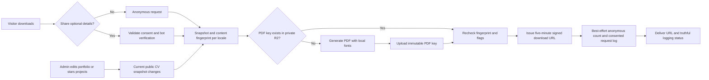

# CV PDF Generation

## Goal

Generate a PDF version of the CV/resume from the same data already shown on the public site
(profile, skills, roles, education and starred projects). Generate it in the backend in English
or Dutch and replace manual resume uploads entirely. Visitors can skip the optional form and
download anonymously. Name, email and reason are all optional and stored only with consent.

## Regeneration strategy: lazy, content-addressed cache

Do **not** regenerate the PDF on a schedule, and do **not** regenerate it fresh on every
request. Content changes are rare and bursty (an admin edit session), while requests are
independent of those edits. The efficient middle ground is to generate on first request after a
change and cache it by a fingerprint of the actual rendered content. No admin save needs to
trigger rendering or update a separate invalidation counter.

### Implementation sketch

1. `ResumeContentService` reads a repeatable-read database snapshot with explicit public-field
   allowlists and feature-flag enforcement. It selects **all starred projects**, newest start
   date first, with no homepage six-project cap. No starred projects means no project section.
2. Hash rendered content, locale and template/font version with SHA-256. Deletions and changes
   to skills, organization names, project selection or flags naturally change the key. Dutch
   CV text falls back to English where missing; this fallback is specific to the CV.
3. `ResumePdfService` uses pinned pdfmake and its bundled Roboto fonts. Markdown is parsed into
   structured PDF text, lists and tables. Raw HTML and Markdown images are ignored. The profile's
   GitHub avatar is the only remotely fetched image: HTTPS on `avatars.githubusercontent.com`,
   no redirects, a five-second timeout, and a two-MiB size limit. It is cropped to a transparent
   circle and embedded at the far right of the header beside name, headline, location and links.
   Without a configured GitHub avatar, use the GitHub profile username; without either, omit the
   portrait. Fetch failures fail generation rather than caching a PDF with a missing portrait.
   Avatar URL changes invalidate the PDF; changing the picture at the same URL is reflected when
   the cached PDF expires (within the configured thirty-day object lifetime).
4. Store immutable `cv/{locale}/{fingerprint}.pdf` objects in private `R2_DOCUMENTS_BUCKET`.
   Experience is grouped by employer with text-only headings, without company logos. All clickable
   links, including project titles and live URLs, are underlined. A padded horizontal divider
   follows the introduction; highlighted project titles link to localized portfolio project pages,
   external links are labeled "Live URL", and the consolidated Skills section appears last.
   HEAD checks distinguish missing objects from storage errors. Simultaneous misses share one
   in-process generation promise; no queue or distributed lock is needed for one API replica.
5. Recheck the source before signing. Retry once after concurrent content changes, then return
   a retryable failure if edits continue. Existing signed links remain valid for at most five
   minutes. The API returns a signed URL, not proxied PDF bytes.
6. Apply a thirty-day lifecycle to generated objects. Even a current object can expire and be
   regenerated on the next request; there is no scheduled generation job.

## API and admin controls

PDFs currently contain selectable/searchable text and links, but are not tagged or PDF/UA-certified.
Equivalent accessible content remains available on the website; tagged PDF accessibility requires
a separate renderer/accessibility audit.

- `GET /api/resume/download`: anonymous redirect, existing links remain compatible.
- `POST /api/resume/download`: optional details and consent, returns URL plus logging status.
- `POST /api/resume/preview`: authenticated EN/NL preview, bypasses the public RESUME gate but
  respects section flags, and creates no counts or requester records.
- `GET /api/resume/requests`: authenticated, unexpired requests in pages of twenty-five.
- `DELETE /api/resume/requests/{id}`: authenticated deletion with an independent erasure marker.
- `PUT /api/projects/{id}/cv-featured`: authenticated flag-only update; does not clear other fields.

The public request/preview endpoints use `X-Accept-Language` (`en`/`nl`, default English).
Admin Basic Info provides generated previews; Projects provides stars and an "Include in CV"
form control. Manual upload endpoints/components are removed. Legacy Resume metadata is retained
only until its R2 objects can be inventoried and safely cleaned up, not used as a fallback.

## Request log

Identifying details are logged only after valid, freely given consent and Turnstile verification.
The separate checkbox starts unchecked. Downloading with empty optional fields sends an empty payload. Store only
optional name/email/reason, timestamps and consent wording version; never embed them in the PDF.

Anonymous counts store timestamps independently and count issued URLs, not confirmed file reads.
Bounded, handled database writes happen after the artifact is ready. Their failure never fails
the download; the frontend reports when optional details could not be saved.

CV request records expire after six calendar months; contact messages and anonymous events after
twelve. See [gdpr-privacy-notice.md](./gdpr-privacy-notice.md) for bases, rights, notice links and
publication checks, and [backup-restore-uptime-runbook.md](./backup-restore-uptime-runbook.md) for
R2 lifecycle configuration, privacy erasures and restore safeguards.
